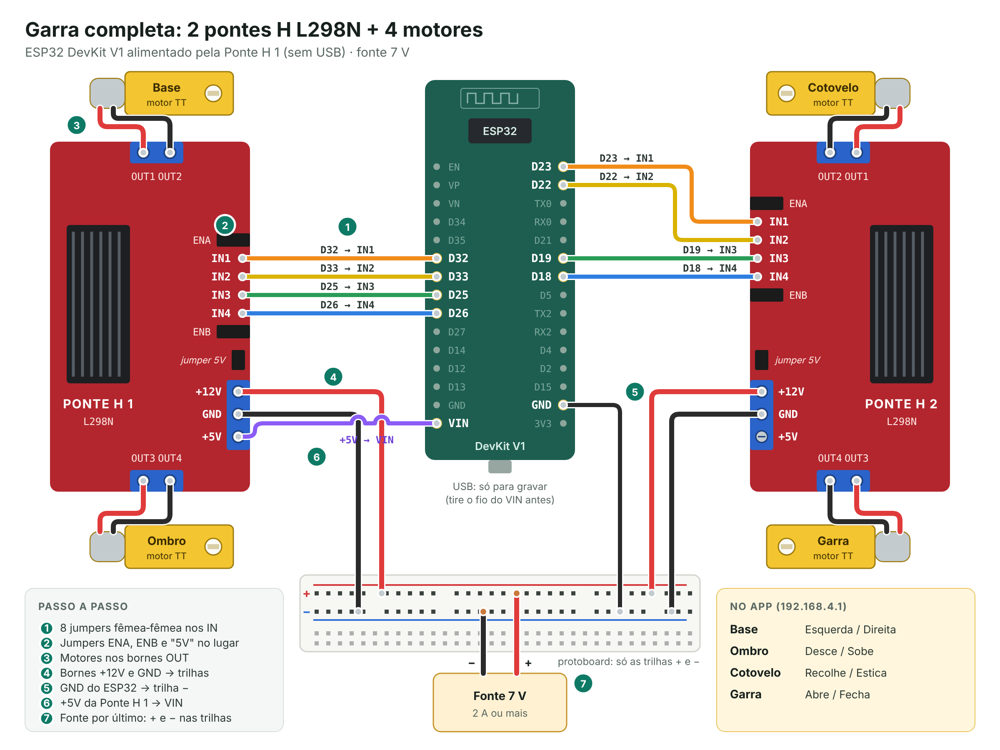

# 4. Ligação elétrica

[← Gravar o firmware](03-gravar-firmware.md) · [Índice](../README.md) · [Próximo: hidráulica →](05-hidraulica.md)

Esta é a montagem final, testada com a **ESP32 DevKit V1 (30 pinos)**. O ESP32 **não usa USB**:
ele recebe 5 V do borne **+5V da Ponte H 1** no pino **VIN**. O USB serve só para gravar o código.

## Por que ponte H?

O motor DC só muda de sentido quando o + e o − dele são invertidos. A ponte H faz essa inversão
sob comando do ESP32. Cada L298N controla 2 motores, por isso são 2 módulos.

## Pinos

| Motor | Ponte H | Entradas | Pinos do ESP32 | Borne do motor |
|---|---|---|---|---|
| Base | 1 | IN1 · IN2 | D32 · D33 | OUT1 · OUT2 |
| Ombro | 1 | IN3 · IN4 | D25 · D26 | OUT3 · OUT4 |
| Cotovelo | 2 | IN1 · IN2 | D23 · D22 | OUT1 · OUT2 |
| Garra | 2 | IN3 · IN4 | D19 · D18 | OUT3 · OUT4 |

A Ponte H 1 usa pinos do lado esquerdo do ESP32 e a Ponte H 2 do lado direito, então os fios
ficam quase retos. Em outras placas a posição física muda, mas os **nomes impressos** são os mesmos.

## Alimentação

| De | Para |
|---|---|
| Fonte **+** (7 V) | trilha **+** da protoboard |
| Fonte **−** | trilha **−** da protoboard |
| Borne **+12V** das duas pontes | trilha **+** |
| Borne **GND** das duas pontes | trilha **−** |
| **GND** do ESP32 (qualquer um) | trilha **−** |
| Borne **+5V da Ponte H 1** | **VIN** do ESP32 |
| Borne +5V da Ponte H 2 | nada |
| **3V3** do ESP32 | **nada, nunca** |

## Passo a passo (os números batem com o desenho)

1. **Sinais:** 8 jumpers fêmea‑fêmea dos pinos do ESP32 até os pinos IN das pontes H, conforme a tabela.
2. **Jumpers:** deixe no lugar as capinhas pretas **ENA** e **ENB** e o **jumper 5V** (do regulador) nas duas pontes.
3. **Motores:** os 2 fios de cada motor no borne OUT (solte o parafuso, encaixe, aperte).
4. **Pontes → protoboard:** borne **+12V** na trilha +, borne **GND** na trilha −, nas duas pontes
   (jumper macho‑macho: uma ponta presa no borne, a outra espetada na trilha).
5. **GND do ESP32 → trilha −** (jumper macho‑fêmea).
6. **+5V da Ponte H 1 → VIN do ESP32** (jumper macho‑fêmea). Essa é a alimentação do ESP32.
7. **Fonte por último:** − na trilha −, + na trilha +.

## Por que fonte de 7 V?

- O L298N "come" cerca de **2 V**: com 7 V na entrada, chegam uns **5 V** nos motores de 6 V.
- O regulador do L298N precisa de **pelo menos 7 V** para gerar os 5 V que alimentam o ESP32.
  Com menos, o ESP32 reinicia ou nem liga.
- Até 9 V funciona, mas aí use a velocidade do app em no máximo ~75% para não passar dos 6 V nos motores.

## Antes de ligar a fonte

- [ ] **GND comum:** o GND do ESP32 e o GND das duas pontes estão na trilha −.
- [ ] Jumpers **ENA/ENB** e **jumper 5V** no lugar nas duas pontes.
- [ ] O **+5V da Ponte H 1** vai no **VIN**. Nada no **3V3**.
- [ ] Fonte de **7 V**, com o fio + conferido no multímetro.
- [ ] Puxe de leve cada fio: nenhum pode sair do borne.
- [ ] A trilha da protoboard não é cortada no meio (em algumas de 830 furos ela é: ligue as duas metades com um jumper).

## Para gravar código de novo

1. Desligue a fonte.
2. **Tire o fio do VIN.**
3. Ligue o USB e grave.
4. Tire o USB, recoloque o fio do VIN e ligue a fonte.

> Faça o primeiro teste **sem as seringas**: veja para que lado cada motor gira. Se estiver
> ao contrário do botão, troque os 2 fios dele no borne OUT (ou use `invertido = true`).
> Se nada girar, grave o [programa de teste dos motores](../firmware/teste_motores/teste_motores.ino)
> para saber se o problema é na montagem ou no app.

## Diagrama antigo

A versão anterior, com o ESP32 alimentado pelo USB e a placa de 38 pinos, continua em
[`docs/img/ligacao-eletrica.png`](../docs/img/ligacao-eletrica.png).
